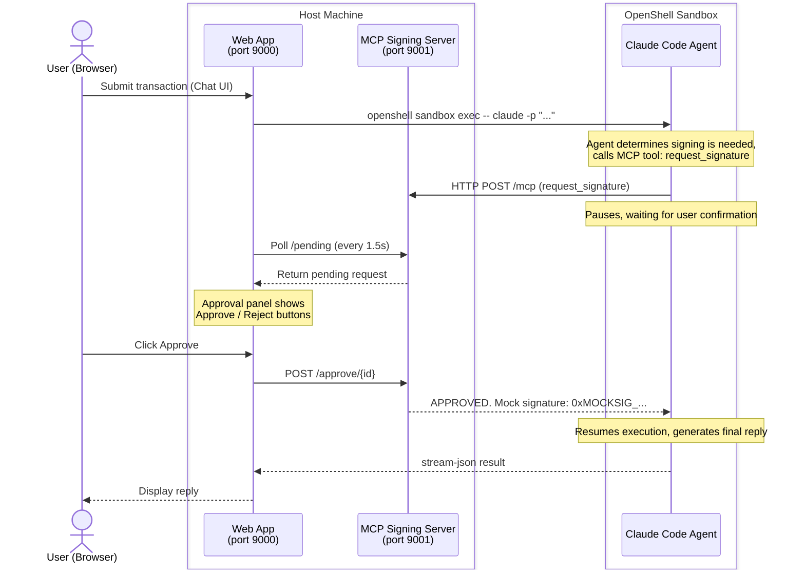

# OpenShell + Claude Code Agent + MCP

## Overview

This PoC demonstrates a **Human-in-the-Loop** signing flow: a Claude Code Agent runs inside an NVIDIA OpenShell sandbox, and the gateway policy restricts it to calling only one MCP service (the signing service). The user submits a transaction request via the Web UI; the Agent calls the MCP tool and pauses, the Approval panel on the right immediately displays Approve/Reject buttons, and once clicked the Agent resumes and returns the result.

### Architecture



### OpenShell Gateway Policy

`policy.yaml` applies a default-deny network policy to the sandbox. The Claude Code Agent can only reach the following endpoints:

| Endpoint | Purpose |
|----------|---------|
| `api.anthropic.com:443` | Anthropic API |
| `statsig.anthropic.com:443` | Claude Code internal |
| `sentry.io:443` | Claude Code internal |
| `raw.githubusercontent.com:443` | Claude Code internal |
| `platform.claude.com:443` | Claude Code internal |
| `host.openshell.internal:9001` | MCP signing service (the only allowed MCP tool) |

> **`host.openshell.internal`** is a special hostname built into OpenShell (analogous to Docker's `host.docker.internal`). It resolves to the host machine's IP from inside the sandbox, allowing sandbox processes to reach services running on the host (such as the MCP Signing Server in this PoC).
>
> **`localhost`** inside the sandbox refers to the sandbox itself. Services running within the sandbox can communicate with each other via `localhost`. However, since the MCP Signing Server runs on the host machine, `host.openshell.internal` must be used instead.
>
> **Note:** The OpenShell gateway has SSRF protection for private IPs. The `allowed_ips` field in `policy.yaml` tells the gateway which private IPs are trusted and should be allowed through. If your host machine IP is not within `172.16.0.0/12`, `10.0.0.0/8`, or `192.168.0.0/16`, run `getent hosts host.openshell.internal` inside the sandbox to get the actual IP and add it to `allowed_ips`.

---

## Directory Structure

```
openshell-claude-mcp-poc/
├── README.md
├── .mcp.json                  # Claude Code MCP config (auto-loaded inside sandbox)
├── policy.yaml                # OpenShell gateway network policy
├── mcp_server/
│   ├── signing_server.py      # MCP Signing Server (FastAPI + FastMCP, port 9001)
│   └── requirements.txt
└── chat_ui/
    ├── app.py                 # Web Chat App (port 9000)
    ├── templates/
    │   └── index.html         # Single-page UI integrating Chat + Approval panel
    └── requirements.txt
```

---

## Prerequisites

- Ubuntu 24.04 LTS (host machine)
- NVIDIA OpenShell 0.0.36+ (requires Docker)
- Python 3.11+ and `uv`
- `ANTHROPIC_API_KEY`

---

## Setup & Launch

### 1. Install OpenShell

```bash
curl -fsSL https://install.openshell.ai | sh
openshell --version
openshell login
openshell whoami
```

### 2. Install uv (Python package manager)

```bash
curl -LsSf https://astral.sh/uv/install.sh | sh
source ~/.bashrc
```

### 3. Set environment variables

```bash
export ANTHROPIC_API_KEY="sk-ant-xxxxxxxx"
echo 'export ANTHROPIC_API_KEY="sk-ant-xxxxxxxx"' >> ~/.bashrc
source ~/.bashrc
```

### 4. Start the MCP Signing Server (Terminal 1)

```bash
cd mcp_server
uv pip install -r requirements.txt
uv run python signing_server.py
# Listening on http://0.0.0.0:9001

# Verify the server is running
# {"status":"ok","service":"mcp-signing-server"}
curl http://localhost:9001/health
```

### 5. Start the Web App (Terminal 2)

```bash
cd chat_ui
uv pip install -r requirements.txt
uv run python app.py
# Listening on http://0.0.0.0:9000
```

### 6. Create a Credential Provider (one-time setup)

OpenShell uses a provider mechanism to inject the API key without exposing the raw credential to processes inside the sandbox:

```bash
openshell provider create --type claude --name claude-key --from-existing
```

### 7. Verify `.mcp.json`

Ensure `.mcp.json` exists in the project root with the following content:

```json
{
  "mcpServers": {
    "signing": {
      "url": "http://host.openshell.internal:9001/mcp",
      "type": "http"
    }
  }
}
```

### 8. Create the OpenShell Sandbox

Run the following from the `openshell-claude-mcp-poc/` directory:

```bash
openshell sandbox create \
  --name wallet-agent \
  --policy policy.yaml \
  --upload .:/sandbox \
  --provider claude-key \
  -- claude --mcp-config /sandbox/.mcp.json
```

`--upload .:/sandbox` uploads the current directory into the sandbox at `/sandbox` (including `.mcp.json`).

> **Note:** `sandbox create` only needs to be run once. To run the Claude Agent again afterwards, use `exec` instead of rebuilding the sandbox:
> ```bash
> openshell sandbox exec --name wallet-agent -- claude \
>   --mcp-config /sandbox/.mcp.json \
>   --dangerously-skip-permissions \
>   --system-prompt "You are a crypto wallet signing assistant. When the user submits a transaction request, use the request_signature tool to submit it for review. Please respond in Traditional Chinese by default, unless the user specifies another language." \
>   --output-format stream-json \
>   --verbose
>
> - `--dangerously-skip-permissions`: Bypasses Claude Code's interactive confirmation prompts. The sandbox has no TTY; transaction signing confirmation is handled via MCP approve/reject, and unsafe operations are restricted by the sandbox policy.
> - `--output-format stream-json`: Streams output as JSON events so the Web App can display replies in real time.
> - `--verbose`: Emits full event stream (including tool calls) for debugging.
> ```

---

## Usage

1. Open `http://<host-ip>:9000`
2. Enter a transaction request on the left, e.g.: `Transfer 0.5 ETH to 0xDEADBEEF`
3. The Agent calls the MCP tool and pauses; the Approval panel on the right displays the request
4. Click **Approve** (or **Reject**)
5. The Agent resumes and displays the signing result on the left:

```
The transaction has been approved! Here's a summary:
- Action: Transfer
- Amount: 0.5 ETH
- Recipient: 0xDEADBEEF
- Mock Signature: 0xMOCKSIG_66884FAA
```

---

## MCP Signing Server API

| Method | Path | Description |
|--------|------|-------------|
| `GET` | `/health` | Health check |
| `GET` | `/pending` | Get list of pending signature requests |
| `POST` | `/approve/{id}` | Approve a request; Agent resumes execution |
| `POST` | `/reject/{id}` | Reject a request; Agent receives rejected reply |
| `POST` | `/mcp` | MCP endpoint (used by Claude Agent) |

---

## Key Implementation Details

### FastMCP DNS Rebinding Protection

FastMCP validates the HTTP `Host` header by default. When called from within the sandbox using `host.openshell.internal`, it will be rejected (421 Invalid Host). Solution:

```python
from mcp.server.transport_security import TransportSecuritySettings

mcp = FastMCP(
    "signing-server",
    transport_security=TransportSecuritySettings(enable_dns_rebinding_protection=False),
    streamable_http_path="/",
)
```

### MCP Mount Path

The FastMCP app is mounted at `/mcp`, and combined with `streamable_http_path="/"`, the MCP endpoint is accessible at `/mcp/`:

```python
app.mount("/mcp", mcp.streamable_http_app())
```

`.mcp.json` configuration:
```json
{ "mcpServers": { "signing": { "url": "http://host.openshell.internal:9001/mcp", "type": "http" } } }
```

### Approve/Reject Using async

FastAPI executes synchronous functions in an AnyIO worker thread and cannot directly call `asyncio.get_event_loop()`. The `approve` and `reject` endpoints must be declared as `async def`:

```python
@app.post("/approve/{request_id}")
async def approve(request_id: str):
    _resolve(pending[request_id], "approved")
    return {"status": "approved"}
```

### SSRF Protection and allowed_ips

The OpenShell gateway blocks hostnames that resolve to private IPs by default. The `policy.yaml` file needs to include `allowed_ips`:

```yaml
- host: host.openshell.internal
  port: 9001
  allowed_ips:
    - 172.16.0.0/12
    - 10.0.0.0/8
    - 192.168.0.0/16
```

---
